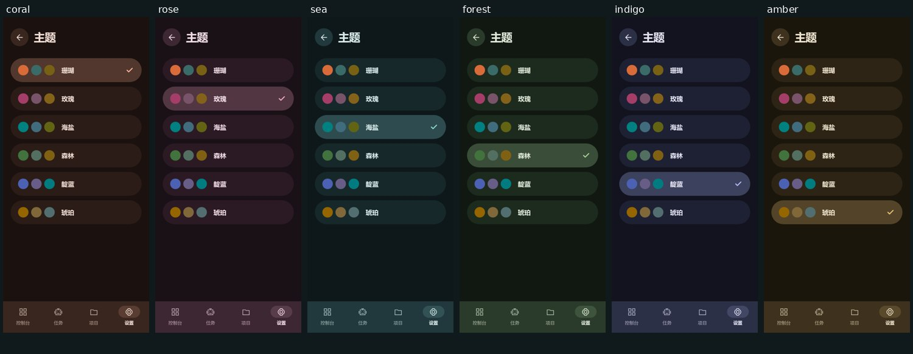
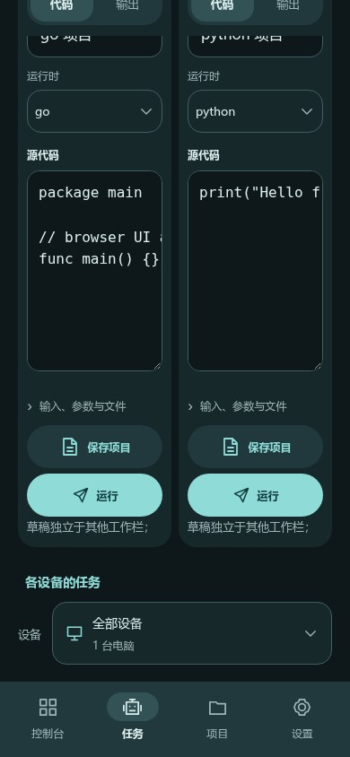
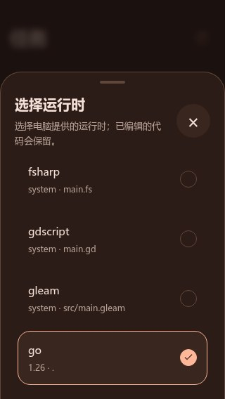
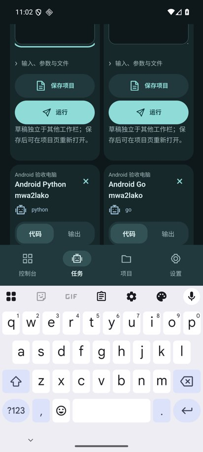
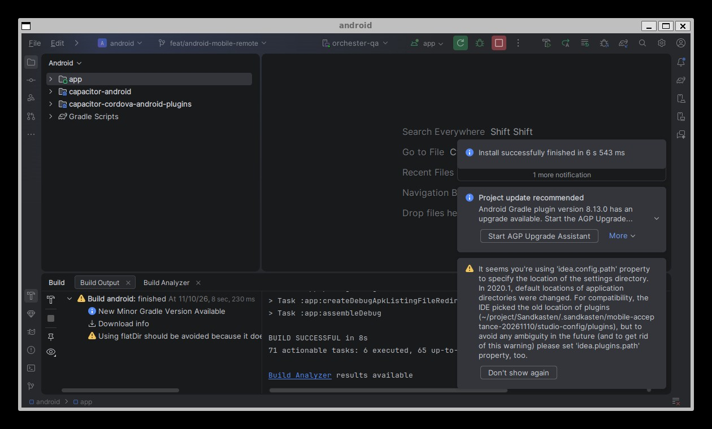
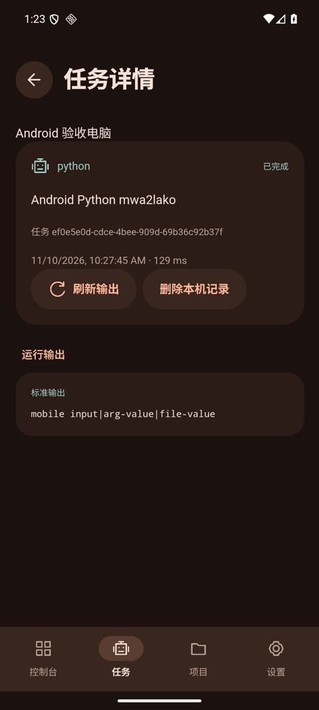
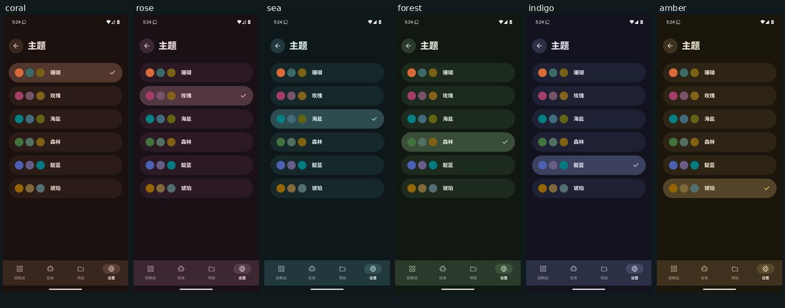
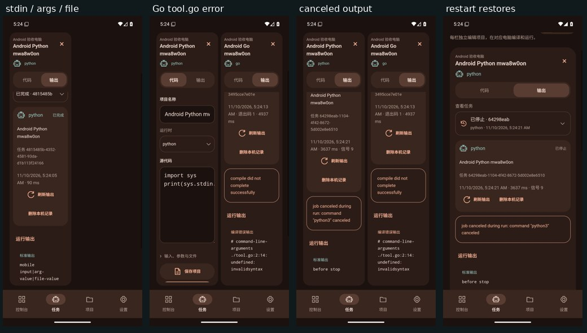

# Android 手机端验收

日期：2026-11-10。需求来自会话 `01a1c024-b09f-7043-89ca-c53a7b415e7b`：参照本机 Orchester 的 UI、布局和风格实现 Sandkasten Android 远程控制端，并在本机测试。操作与构建命令见 [手机端 README](../../apps/mobile/README.md)。

## 当前结果

应用支持四导航、六主题、单双栏、多设备令牌连接、全部服务端运行时、本机源码项目、输入/参数/文本文件、执行输出、停止、自动重连和恢复。默认双栏在 320px 和 390px 手机上均保留可用源码宽度；运行时与动作按钮保持单行。应用 ID 为 `dev.sandkasten.mobile`。

| 验证 | 已取得的证据 |
| --- | --- |
| 手机业务 | 80 项 Vitest 测试通过，含终态输出首读失败后的自动恢复及原生主题持久化竞态；类型检查与生产构建通过；[日志](proofs/mobile-logic-build.log) |
| 手机浏览器 UI | 320×568、390×844，六主题、四导航及选择面板；718/718 断言、124 张截图，0 JS 错误、0 水平溢出；[结果](proofs/browser-mobile.json) |
| 桌面预览与参考样式 | 1280×900，33 项页面/截图检查通过；Orchester 与当前 164 条共有 CSS 规则及六主题定义一致；[桌面结果](proofs/browser-desktop.json)、[参考比较](proofs/reference-style.json) |
| Go API / Postgres | `go test ./... -count=1` 通过，包含隔离真实 Postgres 的输出就绪契约测试；[日志](proofs/go-tests.log) |
| Rust 取消修复 | core 18 + store 8 + sandbox 30 项测试通过；实进程 stdout/stderr 保留、进程及后代回收；真实 PostgreSQL 并发取消/完成、旧轮次与重复写入测试通过；workspace check 与 clippy 通过；[测试](proofs/runner-tests.log)、[并发](proofs/runner-postgres-races.log)、[clippy](proofs/runner-clippy.log) |
| Android 包 | SDK 36 / JDK 21；debug APK、测试 APK 和 lint 构建通过，CI lint 0 errors / 25 warnings，本机 IDE lint 0 errors / 26 warnings；两份包内 5 个 Web 资源与 `dist` 字节一致；[lint](proofs/android-lint.json)、[包身份](proofs/ci-apk.json) |
| 原生安装测试 | CLI 构建包 `db07d75c…` 在 Android 16 / API 36 模拟器，Keystore、原生 HTTP bearer、六主题窗口/重建、系统返回四项通过；从设备读取的安装包哈希与构建一致；[记录](proofs/local-native-tests.json)、[日志](proofs/native-tests.log) |
| 本机 Android Studio | Rabbit 2 / 2026.2.2 Patch 1，工程真实同步、最新源码 IDE Build、Run 安装并启动通过；最终 IDE 安装包 `2bbd3004…` 与设备包哈希一致，四项原生测试通过，41.624 秒，包含旧 Web 缓存被原生主题恢复的回归；[记录](proofs/studio-acceptance.json)、[IDE 日志](proofs/studio-ide.log)、[原生测试](proofs/studio-native-tests.log) |
| 软键盘与真实触摸 | 同一 CSS 的安装包上，ADB 点击源码并滑动页面/两栏，键盘保持显示时四个保存/运行按钮均命中且完整可见；真实点击保存写入本机项目；[记录](proofs/keyboard-acceptance.json)、[布局](proofs/keyboard-layout.json) |
| Go 自定义入口 | 最终 API + 本机真实运行器，`tool.go` 和 `cmd/echo.go` 均成功执行并返回精确 stdout，保留路径返回 400；[任务 ID 与结果](proofs/local-custom-go.json) |
| 本机强退恢复 | CLI 构建包 `db07d75c…` 连续三次强退重启；Keystore 自动连接、58 个真实运行时、选中任务及输出、四工作栏、四导航、珊瑚主题与单栏偏好均恢复；[结果](proofs/local-restarts.json) |
| 最终包快速强退 | IDE 安装包 `2bbd3004…` 通过实际界面由琥珀切换珊瑚，确认原生保存后立即返回并强退重启，主题、工作栏与布局恢复一致，0 JS 错误；[记录](proofs/studio-theme-restart.json) |
| 真实 cgroup 取消 | 特权 Linux 环境，取消前 stdout/stderr、执行统计、进程及后代回收全部通过，1 passed / 0 ignored；[日志](proofs/privileged-cancellation.log) |
| 真实安装版 E2E | 最终 CI 全部通过：Python stdin/参数/文件、Go 自定义入口编译错误、停止并保留最终输出、Keystore/主题/单栏/工作栏/输出强退恢复；4 项综合检查、37 张原生截图、0 JS 错误与水平溢出；[安装版结果](proofs/native-e2e.json)、[真实 API 任务](proofs/native-api-jobs.json)、[CI 原生四测](proofs/ci-native-tests.log) |

浏览器 UI 检查仅向真实认证 API 请求 58 个运行时，没有提交任务；远程运行证据单独来自安装版。模拟器测试不能证明物理手机、release 签名或商店发布。

## 视觉证据

浏览器六主题：

手机双栏与运行时面板：

安装版软键盘显示时，两栏按钮仍可操作：

本机 Android Studio 的 IDE 构建与安装，以及对应安装包显示的真实 Python 输出：

完整 CI 安装版的六主题与远程执行结果：

## 真实服务与复验

本机使用隔离 Postgres 端口 55432、HTTP API 18080、gRPC 55051、Rust 私有命名空间/cgroup/seccomp 沙箱与 Android API 36 模拟器。测试使用临时凭据和独立数据库，没有复用生产数据。

取消请求先改变任务状态，最终输出可能稍后写入；新增 `outputReady` 使客户端持续补取。Rust 运行器另修复取消分支丢弃 stdout/stderr 的问题，保留执行统计并终止、回收所有后代。既有旧版运行器上的失败记录没有计为修复后的通过证据。

取消与自然结束相撞时，持久化事务按数据库中的取消状态收尾，保留输出、执行轮次与事件的一致性；行锁和当前轮次校验阻止重复完成或旧运行器覆写。手机首次读取历史输出遇到临时网络失败后会按任务 ID 重试，成功补取或移除本机记录后停止。

主题快速强退测试另发现 WebView 缓存可能读回旧值。Android 改为从原生偏好恢复主题，原生写入成功并应用窗口后确认保存；连续选择按顺序提交，旧初始化结果不能覆盖新选择。原生测试包含故意保留旧 Web 缓存后重建仍恢复正确主题的回归场景。

本机 WSL 创建新 root 进程出现 `Wsl/Service/E_UNEXPECTED`，旧运行器继续运行；本机运行证据与修复后取消证据分别记录。完整验收在独立 Linux 环境启动真实服务和 Android 模拟器，保持 cgroup、命名空间与 seccomp 沙箱要求。[Android 工作流](../../.github/workflows/mobile.yml)的 [42761172025](https://github.com/dieWehmut/Sandkasten/actions/runs/42761172025) 已全部通过，验证源码为 `90d17da1c6b61d5912a4ec5cad9c609371eab856`；[完整工作流结果](proofs/ci-run.json)与[安装包身份](proofs/ci-apk.json)绑定同一提交及被测试 APK 哈希。

Python 成功任务 `4815485b-4352-4581-93da-d1b113f24166` 返回 `mobile input|arg-value|file-value`；Go 任务 `36679e5d-b9e5-4370-a754-3495cce7e01e` 的编译器读取 `tool.go` 并报告 `invalidsyntax`；取消任务 `64298eab-1104-4f42-8672-5d002e8e6510` 返回 `outputReady=true` 和 `before stop`，未执行取消后的标记语句。完整状态、输出及执行统计保留在[任务结果](proofs/native-api-jobs.json)。

## 提交与远端

API、手机业务、原生工程、CI、取消输出与竞态修复、窄栏布局、历史输出重试和原生主题持久化已分别提交并推送 `feat/android-mobile-remote`。完整验收对应代码提交 `90d17da`；本记录与操作文档、日志和截图使用快进合并交付到 `main`，文档提交只补充说明与证据。
