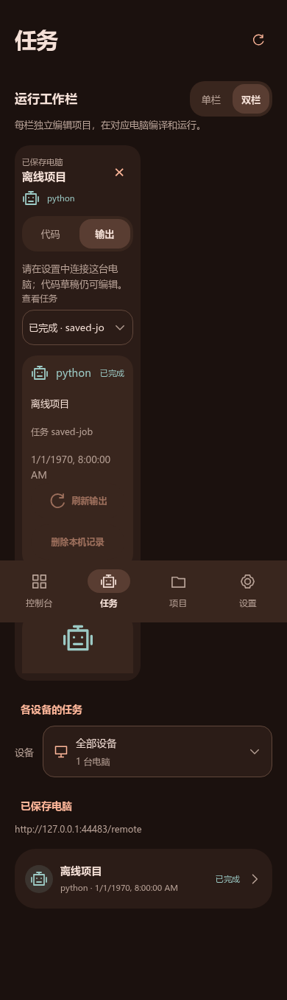
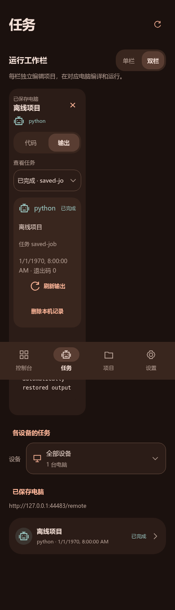

# 保存设备的离线启动恢复

日期：2026-11-20。修复提交 `5f0d4e4`，原生回归与 CI 入口提交 `e62bb55`。

## 问题与修复

已保存电脑在手机启动时暂时不可达，原实现只尝试一次运行时目录连接，网络恢复后仍需手动点击重连。目录请求挂起时，保存的工作栏也会等待网络请求结束后才显示。

现在先恢复工作栏、已保存源码和已选任务，再连接电脑。已保存设备的目录读取遇到暂时故障时按 1、2、4、8、16、30 秒递增重试，之后维持最多 30 秒的间隔。恢复连接后读取已有任务的权威输出，不重放运行或停止请求。

同时验证以下边界：连续刷新共用同一次连接；更新令牌使旧尝试失效；移除设备和销毁控制器清除定时器；HTTP 401/403/404 及原生凭据读取或写入失败不自动重试；尚未保存的新令牌不会在失败后退回旧令牌重试。重连不会重置用户在等待期间切换的任务选择。

## 本机验证

| 验证 | 结果与范围 |
| --- | --- |
| Vitest | 95 项通过；新增定时器退避、最长间隔、临时 HTTP 错误、凭据错误、并发连接、替换令牌与销毁回归 |
| 类型与生产构建 | `npm run build` 通过，包含 `vue-tsc --noEmit` |
| Android 构建 | JDK 21 / SDK 36；debug APK、原生测试 APK、lint 通过，本机 lint 0 errors / 24 warnings |
| APK 资源 | debug APK 中全部 5 个 Web 资源与生产 `dist` 逐字节一致 |
| 实际浏览器页面 | 390×844；首个目录请求挂起时工作栏和已选任务已显示，连续两次 503 后自动恢复；3 次目录 GET、1 次历史输出 GET，没有写请求、JS 错误和水平溢出；[结果](proofs/reconnect-20261120/browser.json) |

浏览器证据使用受控 HTTP fixture，验证生产构建 UI 的恢复行为，不作为安装版或真实沙箱执行证据。

## 安装版验证

新增 `SavedDeviceReconnectTest`，通过安装版 WebView 与 Capacitor 原生 HTTP 请求模拟器内的独立服务器。第一次目录读取保持挂起，先断言工作栏、源码和已选结束任务可见；放行后服务器连续返回两次 503，再返回目录与历史输出。测试核对每次请求的 Bearer、四次请求的顺序与全部为 GET，并在结束后恢复原有本机存储及凭据、关闭 fixture 线程和连接。

Android Studio 可选择共享配置 `Sandkasten SavedDeviceReconnectTest` 单独运行。完整测试包包含原先四项桥接测试和新增的一项恢复测试；CI 要求五项全部通过后才继续真实远程执行验收。

PR #1 的 [Android CI 44662380822](https://github.com/dieWehmut/Sandkasten/actions/runs/44662380822) 已全部通过。API 36 模拟器上的五项原生测试共 37.227 秒，包含新增的自动重连回归；[原生日志](proofs/reconnect-20261120/native-tests.log)明确记录两个测试类及 `OK (5 tests)`。CI lint 为 0 errors / 25 warnings。

同次工作流的真实 API、Postgres 与 Linux 沙箱验收四项全部通过，包含 stdin/参数/文件、实际编译错误、停止并保留最终输出、Keystore/主题/工作栏/输出强退恢复；37 张原生截图、0 JS 错误。[安装版结果](proofs/reconnect-20261120/native-e2e.json)、[实际任务输出](proofs/reconnect-20261120/verified-api-jobs.json)、[真实进程取消](proofs/reconnect-20261120/privileged-test.log)和 [Postgres 取消竞态](proofs/reconnect-20261120/cancellation-race-postgres.log)保留本轮实际结果。

工作流 head 为 `e62bb55`，实际 checkout 的 PR 测试合并提交为 `c361fd1`，两者的手机端和验收脚本逐字节一致。已下载的 CI APK 哈希为 `6a756a0d…f01aef0`，与安装测试使用的 APK 一致；其中五个 Web 资源与本机验证的生产构建逐字节一致。[工作流结果](proofs/reconnect-20261120/ci-run.json)与[包身份](proofs/reconnect-20261120/apk.json)记录完整哈希。完整日志与截图另保留在本机 `.sandkasten/mobile-iteration-20261120/evidence`。

本轮本机 `/dev/kvm` 缺少当前用户的访问权限，Windows 挂载返回 I/O 错误，没有重新执行本机模拟器或 Windows Studio 安装测试；本节安装版结果来自上述 CI 模拟器。Android Studio 中新增的共享入口可以用于后续本机复验。
